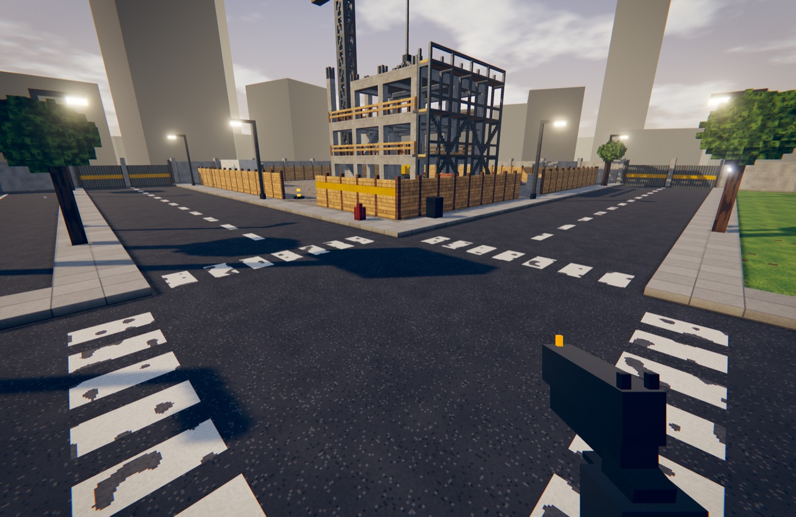
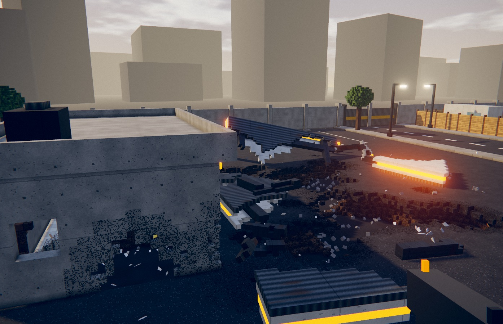

# BREAKPOINT

A first-person voxel destruction sandbox that runs in the browser. Every wall, beam and pane in the district is made of simulated voxels: shoot holes in it, cut it, blast it, and watch what is left standing decide whether it stays standing.

**Play:** https://breakpoint.lou15.com



## What is in it

- **Real destruction.** The world is a 448 × 128 × 448 voxel grid (0.2 m voxels). Damage removes voxels; nothing is a canned animation, and holes stay for the session until you reset.
- **Structural integrity.** Pieces that lose their connection to the ground break off and fall as rigid bodies. Overloaded supports crush. Settled rubble can be destroyed again.
- **Materials that behave differently.** Wood splinters and burns, glass shatters as a pane, brick crumbles, concrete cracks before it gives, steel shrugs off the hammer and has to be cut or blasted.
- **Six tools.** Sledgehammer, pistol, shotgun, explosive charges (remote or timed), rocket launcher and a blowtorch.
- **A compact industrial district.** A freight warehouse, a fuel station that chain-reacts, a brick house, a construction site with a crane, roads, props and vehicles you can drive.
- **Two modes.** Free sandbox, and a scored destruction challenge.
- **Shaders.** Light shafts, bloom, shockwave refraction, contrast-adaptive sharpening, procedural clouds, on-demand shadows.
- **Procedural audio.** Every sound is synthesised at runtime; there are no audio files.



## Controls

| Input | Action |
| --- | --- |
| `W` `A` `S` `D` | Move |
| Mouse | Look |
| `Space` | Jump |
| `Shift` | Sprint |
| `Ctrl` | Crouch |
| `1`–`6` | Select tool |
| Left mouse | Use tool |
| Right mouse | Secondary action (aim, heavy swing, detonate) |
| `R` | Reload, or change charge mode |
| `E` | Pick up, throw, open, drive |
| `Esc` | Pause |

## Run it locally

Needs Node 20 or newer and a browser with WebGL 2.

```bash
npm install
npm run dev
```

Then open http://localhost:5173. `npm run build` type-checks and writes a static site to `dist/`.

## How it is built

TypeScript, [Three.js](https://threejs.org) for rendering, [Rapier](https://rapier.rs) for rigid bodies, Vite for the build. No game engine and no downloaded assets: geometry, textures and audio are generated in code.

```
src/
  engine/       renderer, post-processing, physics wrapper, input, adaptive quality
  destruction/  voxel grid, greedy mesher, damage, structural solver, debris, fire, explosions
  gameplay/     player controller, the six tools, interactions, challenge scoring
  world/        district generator (runs in a worker), materials, props, vehicles
  audio/        procedural sound
  ui/           menus and HUD (plain DOM and CSS)
```

A few design decisions worth knowing before changing things:

- The whole static world is **one** Rapier voxel collider. Removing a voxel is a constant-time edit.
- Large debris does not collide with the world through its real shape, which would mean one contact test per touched voxel. It carries a few dozen small cube probes instead; its real shape still collides with other bodies and the player.
- Only one explosion resolves per simulation tick. Simultaneous blasts ripple across consecutive frames.
- The 3D view has a pixel budget per quality preset, so a Retina window does not render four times the pixels of a 1080p one.

## Performance

The target is 60 fps on a fanless laptop. Quality steps down automatically under load and recovers afterwards; rigid bodies, light debris and particles all have hard limits. Settings has presets, a resolution scale, a frame limiter and a low-power mode.

## Status

Version 0.1. The destruction core, physics, fuel-station chain reactions, reset and adaptive quality have been exercised with scripted runs in Chromium on an M3 MacBook Air. It has not been tested on Firefox, Safari, Windows or touch devices.
